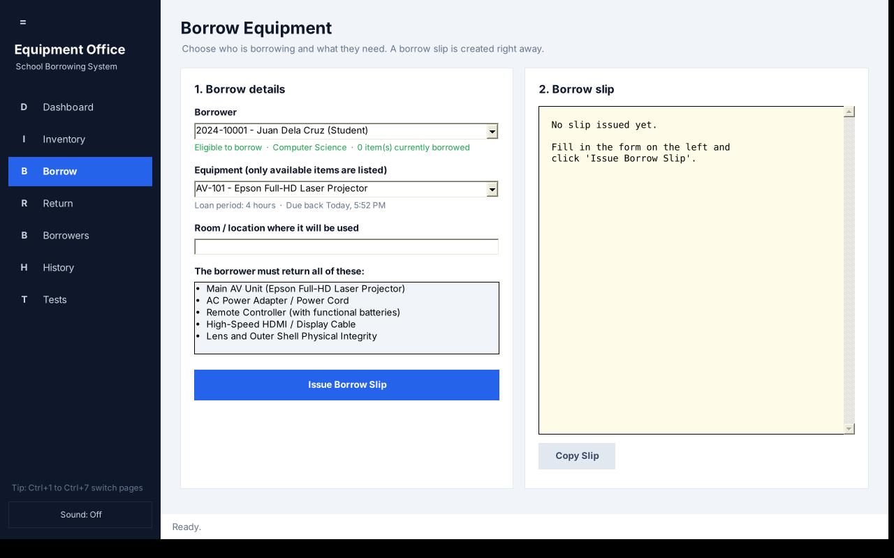

# School Equipment Borrowing System

A Windows Forms app (C# / .NET 8) for a school equipment office: lend projectors and lab equipment,
check them back in, charge fines, and manage clearance holds.



**See [docs/CHANGES.md](docs/CHANGES.md) for a full explanation of every change in this version (what and why).**

## Getting Started in Visual Studio
1. Open `SchoolBorrowingSystem.sln` in Visual Studio 2022.
2. Build with `Ctrl + Shift + B`.
3. Press `F5` to run. The app opens on the **Dashboard** with some sample data.

To run the automated tests, open the **Tests** page in the app and click *Run All Tests*.

## Using the App
The sidebar on the left switches between pages (shortcut: `Ctrl+1` to `Ctrl+7`, `F5` refreshes).

| Page | What you can do |
| --- | --- |
| **Dashboard** | See totals at a glance (equipment, available, on loan, overdue, borrowers on hold) and the loans that need attention. |
| **Inventory** | Search and filter all equipment, add new items, send items to repair, mark them fixed, save/load the inventory file. |
| **Borrow** | Pick a borrower and an available item. The form warns you about clearance holds *before* you click, shows the due time, and prints a borrow slip. |
| **Return** | Select a loan, tick each checklist item that came back, choose the condition, and see the fine **before** confirming. |
| **Borrowers** | Search borrowers, register new ones, place or lift clearance holds. |
| **History** | Every completed return with its condition and fine. |
| **Tests** | Runs all 57 automated tests and shows the results. |

## Responsive Layout
The window works from full screen down to 760 × 540, and at 125% / 150% Windows display scaling.
- **Narrow window:** the sidebar collapses to icons (or use the ☰ menu button), the dashboard cards wrap 2 × 2,
  Borrow and Return stack vertically and scroll, and less important table columns hide.
- **High-DPI screens:** every pixel size goes through `Theme.Scale(...)`, so text and controls never overlap.

Details: [docs/CHANGES.md → Responsive layout](docs/CHANGES.md#3-responsive-layout)

## Business Rules
| Rule | AV Equipment | Lab Equipment |
| --- | --- | --- |
| Loan period | Hours (default 4) | Days (default 7) |
| Late fine | PHP 50 first hour + PHP 25 per extra hour | PHP 100 first day + PHP 50 per extra day |
| Missing parts | PHP 150, item stays unavailable ("Missing Parts") | same |
| Damaged / Needs Repair | PHP 300, item goes to "Under Repair" | same |

Any fine automatically puts the borrower on **clearance hold**, which blocks new loans until staff lift it.

## Project Structure
```
SchoolBorrowingSystem/
├── Models/              SchoolEquipment (abstract), AVEquipment, LabEquipment, SchoolBorrower
├── Transactions/        BorrowSlip
├── Controllers/         EquipmentController, BorrowingController, BorrowerController
├── UI/
│   ├── MainForm.cs      Window with the collapsible sidebar and status bar
│   ├── NavButton.cs     Sidebar button (icon + label, icon only when collapsed)
│   ├── Theme.cs         Colors, fonts, screen scaling and styled-control helpers
│   ├── AudioHelper.cs   Small sound effects (played in the background)
│   ├── Pages/           One class per sidebar page (all inherit BasePage)
│   └── Dialogs/         Add Equipment / Add Borrower pop-ups (inherit BaseDialog)
├── Program.cs           Starts the app and adds sample data
└── TestRunner.cs        Automated tests
docs/
├── CHANGES.md           What changed and why
└── images/              Screenshots
```

## OOP Concepts Used
- **Abstraction** – `SchoolEquipment` is abstract and defines what every item must be able to do.
- **Encapsulation** – private fields with public properties; controllers return *copies* of their lists.
- **Inheritance** – `AVEquipment` / `LabEquipment` extend `SchoolEquipment`; every page extends `BasePage`; dialogs extend `BaseDialog`.
  Pages override `BasePage.ApplyLayout(isNarrow)` to rearrange themselves.
- **Polymorphism** – each equipment type calculates its own due time (`CalculateDueTime`), late fine
  (`CalculateLateFine`) and return checklist (`GetReturnChecklist`), so `BorrowingController` never needs
  to check `if (item is AVEquipment)`.

## Notes
- The UI is built in code (no `.Designer.cs` files), so the forms open as code in Visual Studio rather than in the drag-and-drop designer.
- Borrowers and loans are kept in memory while the app runs. Only the inventory is saved to `school_inventory.txt` (Inventory page → *Save to File*).
