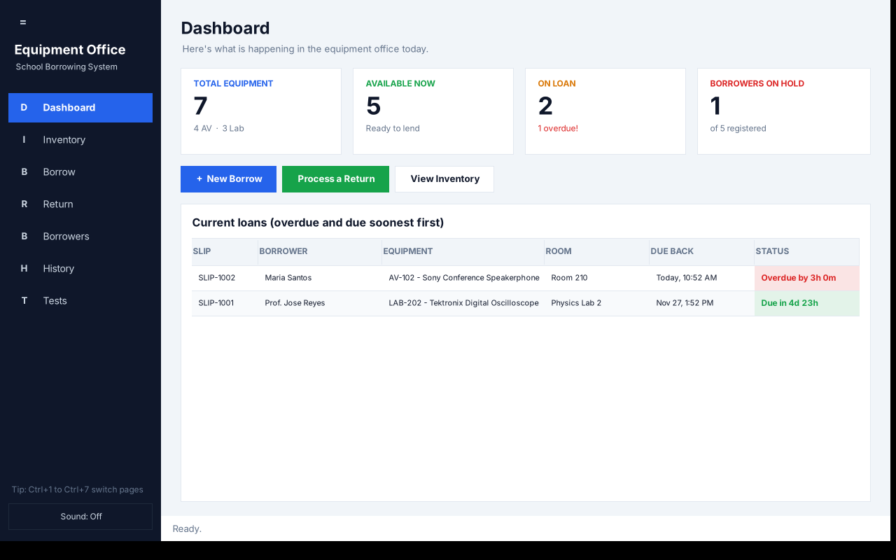
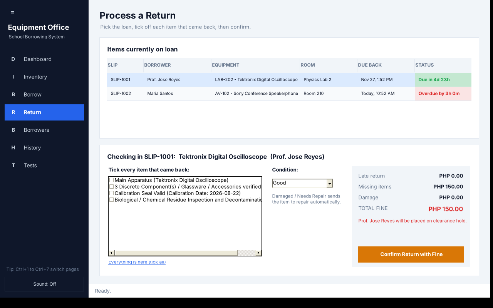
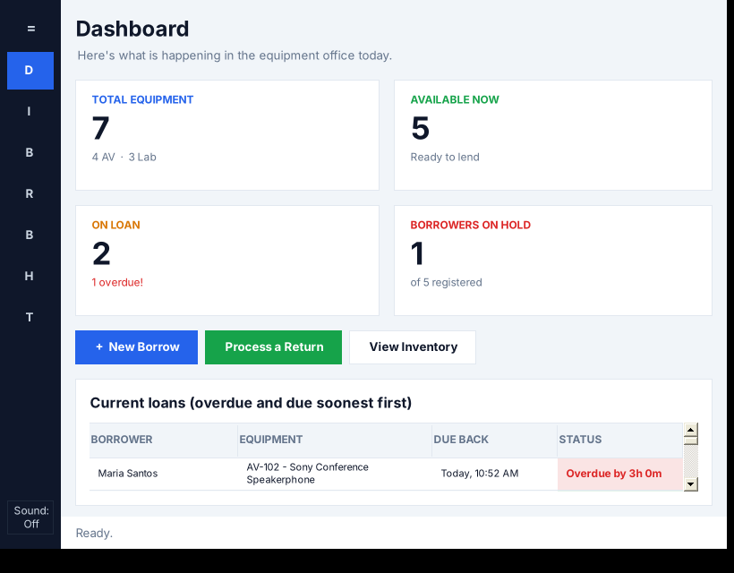
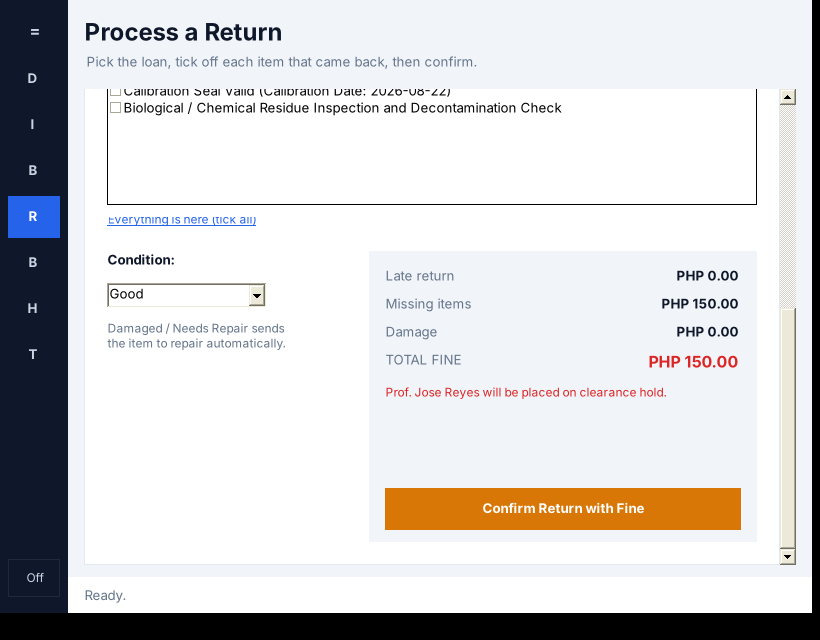

# What Changed and Why

This document explains every change made to the School Equipment Borrowing System in the
`redesign-ui-and-code` branch: **what** changed, **why** it was changed, and **where** to find it in the code.

- [1. Business logic (Models / Controllers)](#1-business-logic-models--controllers)
- [2. New user interface](#2-new-user-interface)
- [3. Responsive layout](#3-responsive-layout)
- [4. Bugs fixed](#4-bugs-fixed)
- [5. Tests](#5-tests)
- [6. Files added, removed and moved](#6-files-added-removed-and-moved)
- [7. Known limitations](#7-known-limitations)

> The screenshots in this document were rendered on Linux (Mono) for preview, so fonts, icons
> and drop-downs look slightly different from Windows. On Windows 10/11 the sidebar shows real icons
> instead of letters.

---

## 1. Business logic (Models / Controllers)

### 1.1 Equipment rules moved into the equipment classes (polymorphism)
**Before:** `BorrowingController` checked the type of each item to decide its rules:

```csharp
if (item is AVEquipment) { dueTime = now.AddHours(...); } else { dueTime = now.AddDays(...); }
if (slip.Equipment is AVEquipment) { /* hourly fine */ } else { /* daily fine */ }
```

**After:** `SchoolEquipment` declares abstract methods and each subclass answers for itself:

| Method | `AVEquipment` | `LabEquipment` |
| --- | --- | --- |
| `CalculateDueTime(timeBorrowed)` | adds hours | adds days |
| `CalculateLateFine(lateBy)` | PHP 50 + PHP 25 per extra hour | PHP 100 + PHP 50 per extra day |
| `GetCategoryName()` | "AV Equipment" | "Lab Equipment" |
| `GetLoanPeriodText()` | "4 hours" | "7 days" |
| `GetDetailsText()` | "Remote, Power cord, HDMI" | "4 part(s), calibrated Oct 22, 2026" |

**Why:** this is what polymorphism is for. Adding a new equipment type (for example `SportsEquipment`)
now only needs a new class. `BorrowingController` doesn't change.

**Where:** `Models/SchoolEquipment.cs`, `Models/AVEquipment.cs`, `Models/LabEquipment.cs`

### 1.2 Constants instead of "magic" strings and numbers
- Condition names (`"Good"`, `"Under Repair"`, `"Missing Parts"`, ...) are constants on `SchoolEquipment`,
  for example `SchoolEquipment.ConditionUnderRepair`.
- Fees are constants: `BorrowingController.MissingPartsFee` (150) and `BorrowingController.DamageFee` (300),
  and the late-fine rates live on `AVEquipment` / `LabEquipment`.

**Why:** a typo like `"Under repair"` vs `"Under Repair"` would silently break the program. With constants,
the compiler catches it.

### 1.3 Fine preview: `CalculatePenalty(...)`
`BorrowingController.CalculatePenalty(slip, condition, checklistComplete, returnTime)` works out the fine
**without changing anything**. `ProcessReturn` uses the same method to charge the fine.

**Why:** the Return page shows staff the fine *before* they confirm, and it always matches the real charge
because both use the same code.

### 1.4 New `BorrowerController`
Borrowers used to be a plain `List<SchoolBorrower>` inside `Program.cs`, passed around to every form.
Now `BorrowerController` owns the list and checks the rules: an ID and a name are required, and IDs can't repeat.

**Where:** `Controllers/BorrowerController.cs`

### 1.5 Other controller improvements
| Change | Why |
| --- | --- |
| `EquipmentController.RestoreToService(tag)` | The old UI changed `Condition` and `IsAvailable` directly. Now the controller does it. |
| `AddEquipment` rejects empty names and the `|` character | `|` is the column separator in the save file and would corrupt it. |
| `LoadInventory` uses small helpers (`ReadExtraValues`, `ReadBool`, `ReadInt`) | Removes two copies of the same parsing loop. |
| `BorrowingController.FindActiveSlipForEquipment`, `CountActiveLoans`, `GetOverdueSlips`, `GetTotalFinesCollected` | Needed by the Dashboard, Inventory and Borrowers pages. |
| `BorrowSlip` now stores `ReturnCondition`, `ChecklistComplete`, `PenaltyCharged` | So the History page can show what happened at return time. |
| `BorrowSlip.GetTimeLeftText()` | Friendly status like "Due in 2h 15m" or "Overdue by 3h 0m". |
| `DisplayName` on `SchoolEquipment` and `SchoolBorrower` | Drop-downs hold the real objects and show this text. |

---

## 2. New user interface



### 2.1 Sidebar navigation instead of tabs
`MainForm` now has a dark sidebar with 7 pages. `Ctrl+1` … `Ctrl+7` jump to a page and `F5` refreshes.
Each page is its own class in `UI/Pages/` and inherits from `BasePage`.

**Why:** the old `MainForm.cs` was one 515-line file doing everything. Small page classes are easier to read,
test and change, and `BasePage` holds what they all share (title, status messages, helpers).

### 2.2 The pages
| Page | What's new |
| --- | --- |
| **Dashboard** | Summary cards (total / available / on loan + overdue / on hold) and a list of loans, most urgent first. |
| **Inventory** | Search, filter (All / Available / On Loan / Needs attention), status badges, Add Equipment, Send to Repair, Mark as Fixed. Buttons are disabled when they don't apply to the selected row. |
| **Borrow** | Warns about a clearance hold *before* you click (and disables the button), shows the loan period and due time, previews the checklist, and prints a slip you can copy. |
| **Return** | Staff tick **each** checklist item instead of one "all intact" box, pick the condition, and see the fine as they go: late + missing + damage = total. Asks for confirmation before charging a fine. |
| **Borrowers** | Search, filter, register new borrowers, place or lift holds (with confirmation). Shows how many items each person has borrowed. |
| **History** | All returns, newest first, with on time / late, condition and fine. |
| **Tests** | Runs the automated tests and shows "All 57 tests passed". |



### 2.3 Dialogs
`UI/Dialogs/BaseDialog.cs` gives every pop-up the same layout: Enter saves, Esc cancels, and errors appear in
red inside the window instead of in an extra message box.
- **Add Equipment:** pick AV or Lab with radio buttons. Only the fields for that type are enabled, and the next free tag (e.g. `AV-105`) is suggested.
- **Add Borrower:** new. Before, there was no way to add borrowers from the UI.

### 2.4 Theme
All colors, fonts and "make a styled control" helpers are in `UI/Theme.cs`. Changing the look of the whole
app means editing one file.

### 2.5 Sound effects
**Before:** every note was played with `PlaySync()`, which **froze the window** until the sound ended, and a
click sound played on every tab change.
**After:** all the notes of a sound are written into one WAV in memory and played in the background with
`Play()`. The click sound on navigation is gone, and there's a Sound on/off button in the sidebar.

**Where:** `UI/AudioHelper.cs`

---

## 3. Responsive layout

The window can now be resized down to 760 × 540 and still work at 125% / 150% Windows display scaling.

| Wide window | Narrow window |
| --- | --- |
|  |  |

### 3.1 How it works
1. **`BasePage.OnSizeChanged`** checks whether the page is narrower than `BasePage.NarrowBreakpoint` (900 px,
   scaled). When the page crosses that line, it calls **`ApplyLayout(bool isNarrow)`**, which each page overrides.
   It runs only when the mode *changes*, not on every pixel of resizing.
2. **`MainForm.OnResize`** collapses the sidebar to icons only when the window is narrower than 1100 px.
   The **menu button** at the top of the sidebar collapses/expands it by hand, and tooltips show the page names
   while it's collapsed.
3. **`Theme.Scale(px)`** multiplies every pixel size by the Windows display scale (125% → ×1.25).
   Fonts grow by themselves, but sizes written in pixels (`Height = 40`) don't, which used to make text overlap
   on laptops.

### 3.2 What each page does when narrow
| Page | Narrow layout |
| --- | --- |
| Sidebar | Icons only (`NavButton` draws the icon; if the icon font is missing it shows the first letter). |
| Dashboard | Cards go from 4 in a row to 2 × 2. The Slip and Room columns hide. |
| Inventory | Category, Loan Period and Details columns hide. The toolbar wraps onto two lines. |
| Borrow | The form and the slip stack vertically and the page scrolls. |
| Return | Loans table, then the checklist full width, then condition and fine side by side. The page scrolls. |
| Borrowers | Role and Department columns hide. |
| History | Slip, Borrowed and Condition columns hide. |
| All pages | Smaller page padding. The subtitle wraps instead of being cut off. Long status messages end with "…". |

| Return page (narrow, scrolled down) |
| --- |
|  |

### 3.3 Layout techniques used (and why)
- **`TableLayoutPanel` with `AutoSize` rows** instead of fixed `Location = new Point(x, y)`: rows grow with the
  text, so nothing overlaps at bigger scaling. Used in the stat cards, page header and Borrow form.
- **`FlowLayoutPanel` with `WrapContents = true`** for toolbars: buttons move to the next line when there's no room.
- **`SetCellPosition` / `SetColumnSpan`**: the same controls are moved between cells instead of building the
  page twice, so nothing you've typed or selected is lost when the layout switches.
- **`ContentArea.AutoScroll = true`** in narrow mode on Borrow and Return, so stacked content can scroll.
- **`Theme.SetColumnsVisible(grid, visible, ...)`**: hides table columns by name.

**Where:** `UI/Pages/BasePage.cs` (`ApplyLayout`, `OnSizeChanged`), `UI/MainForm.cs` (`SetSidebarCollapsed`,
`OnResize`), `UI/NavButton.cs`, `UI/Theme.cs` (`Scale`, `SetColumnsVisible`), and the `ApplyLayout` method in each page.

---

## 4. Bugs fixed
| Bug | Fix |
| --- | --- |
| **Add Equipment form could never be opened** (no button called it). | "+ Add Equipment" button on the Inventory page. |
| **No way to add borrowers.** | "+ Add Borrower" button and dialog. |
| **Loading the inventory file while items were on loan** replaced the item objects, so open slips pointed at items that no longer existed. | Loading is blocked (with an explanation) while loans are open, and it asks before replacing data. |
| **Drop-downs found the selected item by its position** in a list that could change between filling and clicking. | Drop-downs and table rows hold the real objects (`Items.Add(item)`, `row.Tag = item`). |
| **The window froze while sounds played.** | Sounds play in the background (see 2.5). |
| Incomplete returns left the item as "Good" but unavailable, with no explanation. | The item is marked **Missing Parts** and can be restored with "Mark as Fixed". |
| Table cells were colored by looping over every row to find the new one. | Uses `grid.Rows[rowIndex].Cells["Status"]` directly. |

---

## 5. Tests
`TestRunner.cs` grew from 44 to **57** checks. The original 44 still pass unchanged. New scenarios:

| Scenario | Checks |
| --- | --- |
| 12 – Exact fine amounts & live preview | AV / Lab fine formulas, due time from `CalculateDueTime`, the preview adds all fees and changes no data. |
| 13 – Restoring after repair / missing parts | "Missing Parts" condition, the slip remembers the fine, `RestoreToService`. |
| 14 – Borrower registration rules | Duplicate ID rejected, empty name rejected, lookup by ID works. |

`TestRunner.PassedCount` / `FailedCount` let the Tests page show the totals without hard-coding "44".

---

## 6. Files added, removed and moved

**Added**
```
Controllers/BorrowerController.cs
UI/Theme.cs, UI/NavButton.cs, UI/MainForm.cs, UI/AudioHelper.cs
UI/Pages/BasePage.cs, DashboardPage.cs, InventoryPage.cs, BorrowPage.cs,
         ReturnPage.cs, BorrowersPage.cs, HistoryPage.cs, TestsPage.cs
UI/Dialogs/BaseDialog.cs, AddEquipmentForm.cs, AddBorrowerForm.cs
docs/CHANGES.md, docs/images/*.png
```

**Removed:** the whole `Models/UI/` folder: the old `MainForm`, `BorrowForm`, `ReturnForm`, `AddEquipmentForm`
(`.cs` + `.Designer.cs` + `.resx`) and `AudioHelper`. `BorrowForm` and `ReturnForm` were never opened anywhere.
The UI didn't belong inside `Models/` anyway, so it moved to `UI/`.

**Changed:** all model, transaction and controller classes, `Program.cs` (uses the three controllers and has
generic sample names), `TestRunner.cs`, `README.md`, `QA_REPORT.md`.

---

## 7. Known limitations
- The forms are built in code (no `.Designer.cs`), so Visual Studio opens them as code, not in the drag-and-drop designer.
- Only the inventory is saved to a file. Borrowers and loans are kept in memory while the app is open.
- Sidebar icons use the *Segoe MDL2 Assets* font that comes with Windows 10/11. On older Windows the sidebar
  shows the first letter of each page instead.
